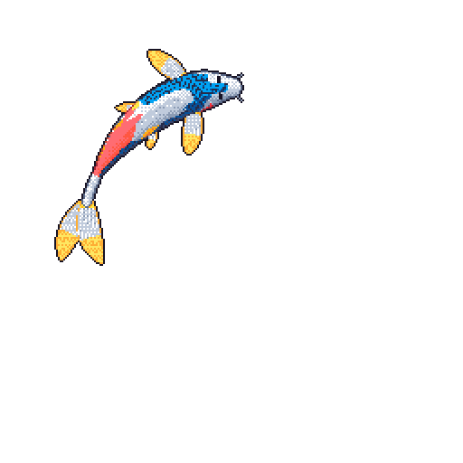

# Abdalrahman

  <i>DevOps engineer passionate about automation, infrastructure as code, and building scalable systems.</i>

  
  

---

## Tech Stack

### DevOps & Infrastructure

  
  
  
  
  
  
  
  
  

### Backend & Databases

  
  
  
  
  

### Languages & Tools

  
  
  
  
  

---

## GitHub Stats

  

<table>
  <tr>
    <td></td>
    <td></td>
  </tr>
</table>

---

  

---

